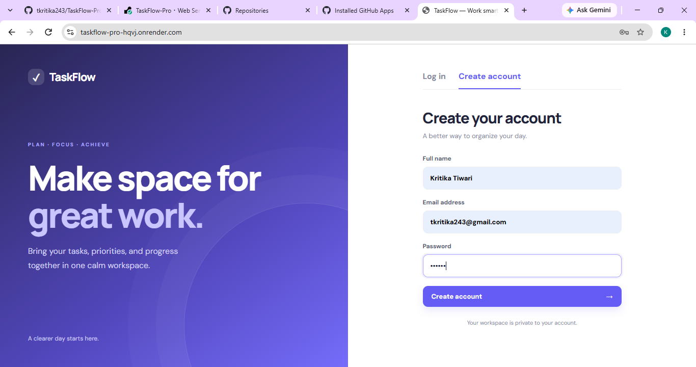
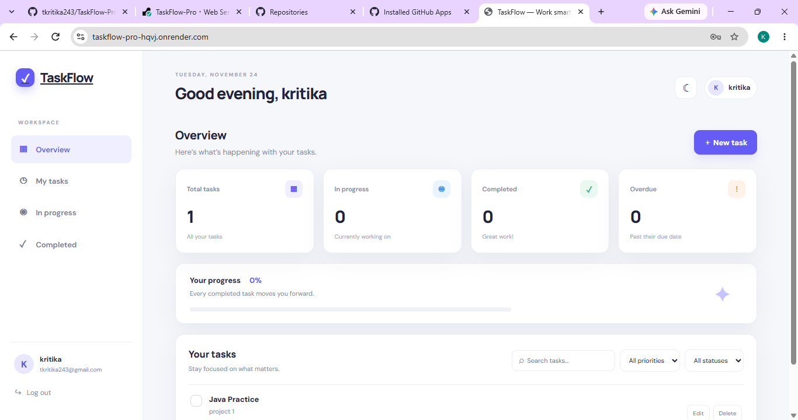
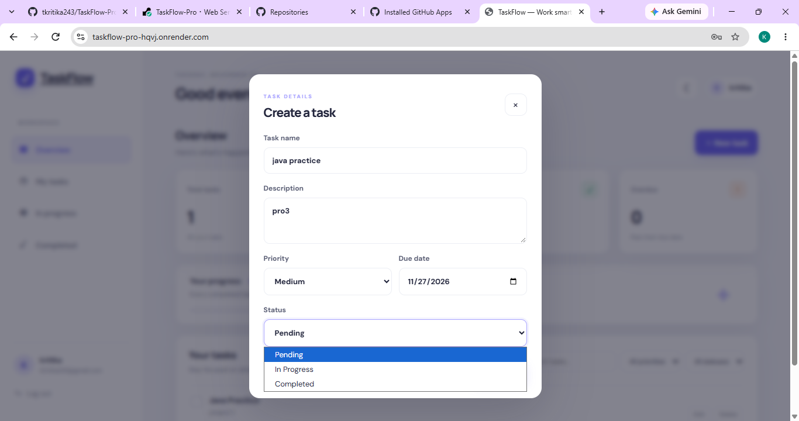

# 🚀 TaskFlow-Pro
### Smart & Simple Task Management Application

A modern and user-friendly task management web application designed to help users organize, manage, and track their daily tasks efficiently.

🌐 **Live Demo:** [TaskFlow-Pro](https://taskflow-pro-hqvj.onrender.com)

💻 **GitHub Repository:** [TaskFlow-Pro](https://github.com/tkritika243/TaskFlow-Pro)

---

## 📸 Application Screenshots

### 🔐 Login Page


### 📊 Dashboard


### 📝 Task Management


---

## ✨ Features

- 🔐 User Registration and Login
- ➕ Create New Tasks
- ✏️ Edit Existing Tasks
- 🗑️ Delete Tasks
- 🔍 Search Tasks
- 📂 Filter and Organize Tasks
- 🔒 Secure Authentication using JWT
- 💾 Store Tasks in MongoDB
- 📱 Simple and User-Friendly Interface

---

## 🛠️ Technologies Used

| Technology | Purpose |
|---|---|
| HTML5 | Website Structure |
| CSS3 | Styling and Design |
| JavaScript | Frontend Functionality |
| Node.js | Backend Runtime |
| Express.js | Backend Framework |
| MongoDB | Database |
| Mongoose | Database Management |
| JWT | User Authentication |

---

## 📁 Project Structure

```text
TaskFlow-Pro/
│
├── backend/
│   ├── middleware/
│   ├── models/
│   ├── routes/
│   ├── server.js
│   └── package.json
│
├── frontend/
│   ├── index.html
│   ├── style.css
│   └── app.js
│
├── screenshots/
│   ├── login.png
│   ├── dashboard.png
│   └── tasks.png
│
├── README.md
└── .gitignore
```

---

## ⚙️ Installation and Setup

### 1. Clone the Repository

```bash
git clone https://github.com/tkritika243/TaskFlow-Pro.git
```

### 2. Open Project Folder

```bash
cd TaskFlow-Pro/backend
```

### 3. Install Dependencies

```bash
npm install
```

### 4. Configure Environment Variables

Create a `.env` file inside the backend folder.

Add the following variables:

```env
MONGO_URI=your_mongodb_connection_string
JWT_SECRET=your_secret_key
PORT=5000
```

### 5. Start the Server

```bash
npm start
```

### 6. Open in Browser

```text
http://localhost:5000
```

---

## 🎯 Project Objective

The main objective of TaskFlow-Pro is to make daily task management easier and more organized.

It helps users create, update, delete, search, and manage their tasks through a simple and easy-to-use interface.

---

## 🌟 Future Improvements

- 📅 Task Due Dates and Reminders
- 📈 Task Progress Dashboard
- 🎨 More UI Customization
- 📱 Improved Mobile Experience

---

## 👩‍💻 Author

**TaskFlow-Pro**

GitHub: [@tkritika243](https://github.com/tkritika243)

Project Repository: [TaskFlow-Pro](https://github.com/tkritika243/TaskFlow-Pro)

---

## ⭐ Support

If you like this project, don't forget to give it a star on GitHub!

**Thank you for visiting TaskFlow-Pro! ❤️**
